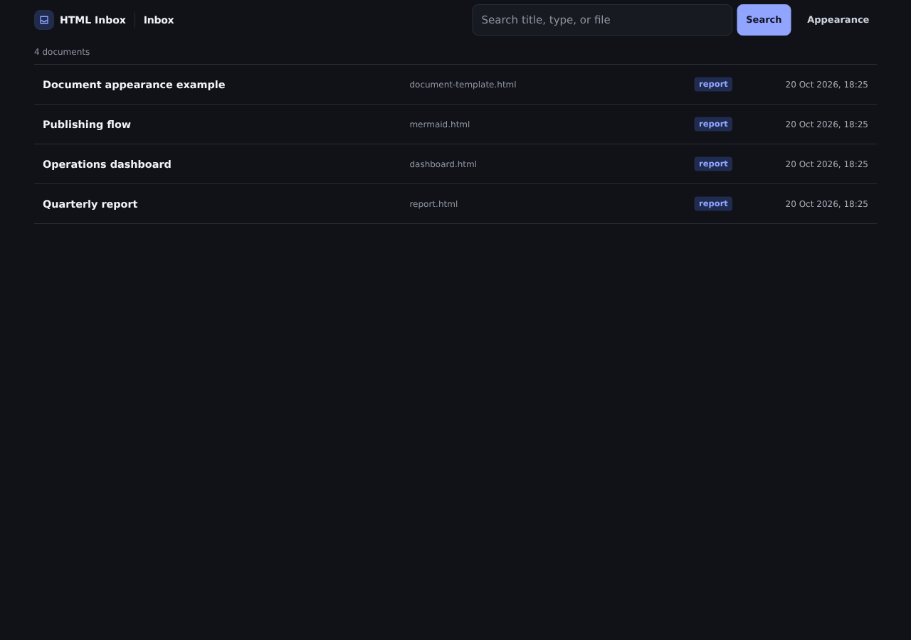
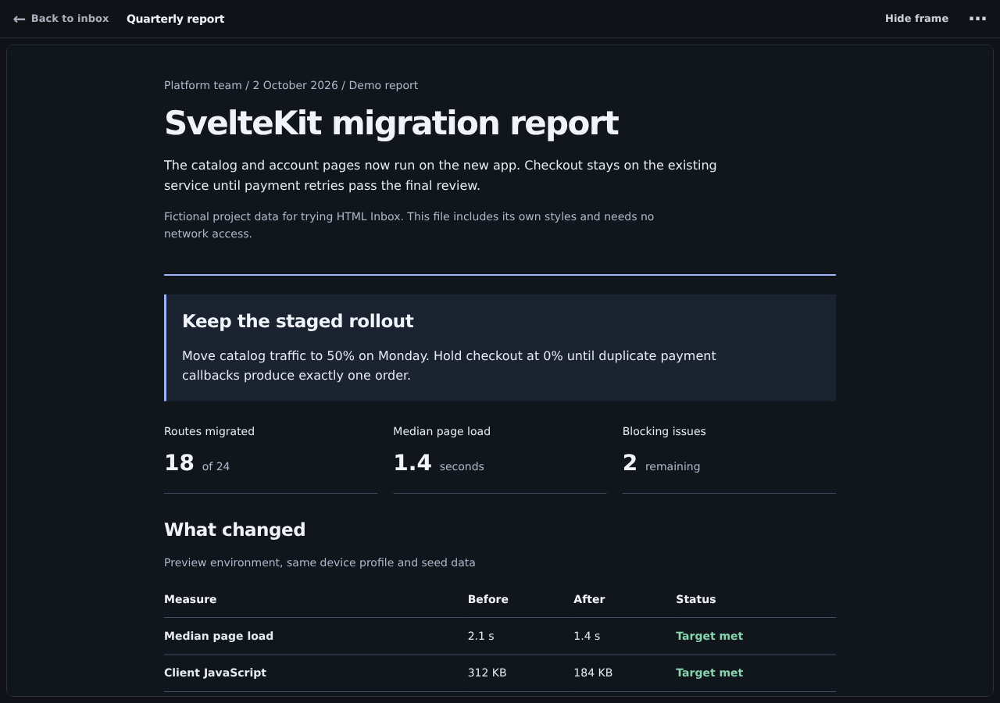
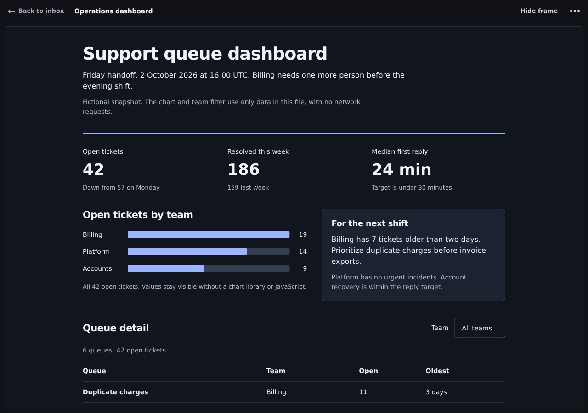
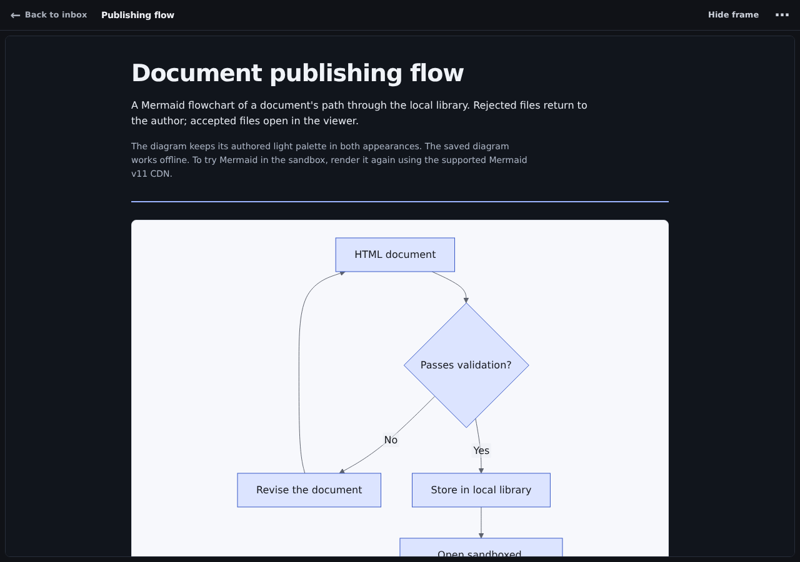
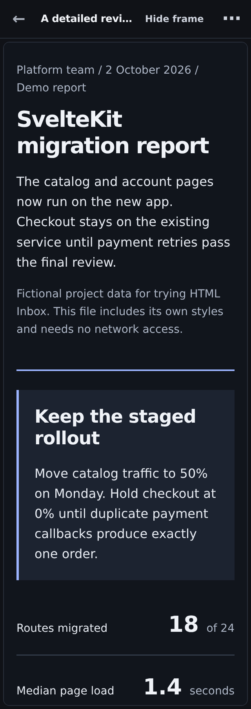

# Try the examples

From a built source checkout, publish any of these files. Each command prints
its local viewer URL. Open that URL, then use **Back to inbox** to see the library.

```sh
corepack pnpm html-inbox publish ./examples/report.html \
  --title "SvelteKit migration report" --type report
corepack pnpm html-inbox publish ./examples/dashboard.html \
  --title "Support queue dashboard" --type dashboard
corepack pnpm html-inbox publish ./examples/mermaid.html \
  --title "Document publishing flow" --type diagram
corepack pnpm html-inbox publish ./skills/html-inbox/assets/document-template.html \
  --title "Document appearance example" --type example
```

If you use the installed CLI, replace `corepack pnpm html-inbox` with
`html-inbox`. See the [source checkout instructions](../README.md#set-up-a-source-checkout-for-development)
if you have not built the CLI yet.

| File | What to try |
| --- | --- |
| [report.html](../examples/report.html) | Read the rollout decision and results table. Open "How the measurements were taken". |
| [dashboard.html](../examples/dashboard.html) | Select Billing, Platform, or Accounts. The queue table and its ticket count update locally. |
| [mermaid.html](../examples/mermaid.html) | View the saved flowchart and expand its source. Choose "Render from source" to run Mermaid v11 in the preview. |
| [document-template.html](../skills/html-inbox/assets/document-template.html) | Switch appearance and open the review notes. The surrounding report changes theme while the white paper preview keeps dark text. |

All data is fictional. The report and dashboard need no network access.
The Mermaid file includes a saved SVG rendered from its source, so it also
works offline. "Render from source" loads the allowlisted Mermaid v11 module
and diagram chunks from jsDelivr. If the CDN is unavailable, the saved diagram
and source remain readable.

The examples use inline CSS, native HTML controls, and scripts registered with
`addEventListener`. They need no framework, external stylesheet, image, font,
or data service. All examples include light and dark styles and follow the
viewer's selected appearance. System follows the reader's OS; Light and Dark
override it. The Mermaid chart keeps its authored light palette while the
surrounding document changes theme. The reusable template also demonstrates an
intentional white paper preview. Open an example standalone to try its OS fallback.

## In the viewer

These Chromium captures show the actual local viewer with the examples and
reusable appearance template above. Desktop captures use a 1280 × 900 viewport;
the mobile capture uses 320 × 900. An extra report with a longer title checks
that the compact toolbar truncates the title with an ellipsis. The full title
remains available in Viewer options with the document metadata.











Open **Viewer options** to choose System, Light, or Dark and inspect document
details. Choose Light or Dark, reload, and confirm that the viewer and document
keep the selected appearance. Keyboard users can open the menu and tab to its
appearance buttons. Browser choices stay on this origin and device.

Choose **Hide frame** to give the document the available browser area, then use
**Show frame** to restore the compact toolbar. An open disclosure or selected
dashboard filter should stay unchanged. Search the inbox for `dashboard` or
`report` to find those examples.
