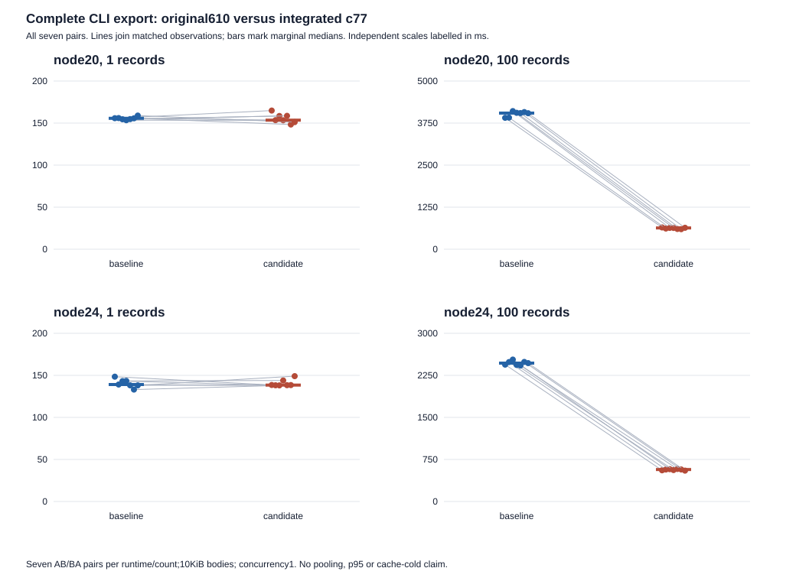

# Measured-package qualification and combined610 results

Related to [#96](https://github.com/deveshsangwan/html-inbox/issues/96) and [draft PR122](https://github.com/deveshsangwan/html-inbox/pull/122).
Tested source **c77ace3c207f302249ba98216caafeab8719dd7b**, immediate parent **b24927abf4cae14c9bbf1753ff6ea2cfb7a945ad**, combined comparison baseline **610c931b7b22920cce59cf03e49c0de15ebaf2a2**. This publication changes documentation/evidence only.

Root accepted normal source qualification from c77 Verify42520123188 on20.20.2/24.22.2 plus existing exact20.20.2/24.19.0 affected local controls. Root also accepted A's measured-TGZ behavior on BOTH exact runtimes through additive bounded credit. Root independently audited B and accepted scoped100-document complete-export practical benefit on BOTH exact runtimes versus original610. The combined610 performance criterion is satisfied for this bounded workload. Two fresh same-pin reviews and root readiness/shared-gate dispositions remain open. Shared observations remain unresolved. This is partial96, draft, no merge/release or issue closure.

## Complete CLI export versus original610

B grant `root-96-combined-610-c77-20261108-r1` ran once, exact20.20.2 then24.19.0. Counts1/100, distinct10240-byte owned bodies, concurrency1 and seven alternating AB/BA pairs were fixed beforehand. Each fresh release-bundle CLI process includes startup, selection, complete checked ledger/body validation, export writes and exit. Real enrollment setup is untimed. No build/typecheck/install, parent mutation, pooling, p95, cold-cache claim or gain-based stopping. Cache conditions are uncontrolled/warm.

Baseline/candidate columns are marginal medians. Changes are medians of seven PAIRED deltas/percentages, not differences/ratios of those medians. Negative changes favor candidate. Original precision remains in CSV/JSON.

| Runtime | Records | Baseline median ms | Candidate median ms | Paired delta median ms | Paired percent median | Paired delta min to max ms | Faster pairs |
| --- | ---: | ---: | ---: | ---: | ---: | --- | ---: |
| node20 | 1 | 155.663 | 153.472 | -0.101 | -0.066% | -7.769 to 9.076 | 4/7 |
| node20 | 100 | 4047.064 | 632.495 | -3422.602 | -84.402% | -3481.279 to -3259.313 | 7/7 |
| node24 | 1 | 139.107 | 138.435 | +0.168 | +0.121% | -9.875 to 10.991 | 3/7 |
| node24 | 100 | 2468.298 | 570.404 | -1916.415 | -77.063% | -1954.666 to -1845.631 | 7/7 |

Both100-record sets have7/7 lower candidate times and disjoint marginal ranges. Node20 baseline3906.520 to4106.186ms versus595.773 to647.207ms; Node24 baseline2425.648 to2531.379ms versus550.764 to580.017ms. Root accepted this bounded host/workload result independently on each runtime. No count1, higher-count/larger-body or cross-host benefit follows.

One-record benefit remains unproven: mixed-sign paired ranges, overlapping marginal ranges,4/7 lower on20 and3/7 on24. The runner polls at5ms; tiny median changes do not establish a gain.

## Complete batch and supporting costs

Batch uses the real serial callback or baseline reader, reads all bodies, compares metadata and whole-body digests and drains the operation. Operation timing excludes module/input setup; process timing includes startup. END RSS is a point sample, distinct from process peak RSS or leak/allocation measurement.

| Runtime,100 records | Metric | Baseline median | Candidate median | Paired delta median | Paired percent median |
| --- | --- | ---: | ---: | ---: | ---: |
| node20 | CLI CPU ms | 4253.539 | 710.204 | -3556.171 | -83.353% |
| node20 | CLI peak RSS KiB | 114356.000 | 82504.000 | -31960.000 | -27.954% |
| node20 | Batch process ms | 3700.165 | 331.354 | -3383.812 | -91.130% |
| node20 | Batch operation ms | 3604.301 | 241.781 | -3366.669 | -93.279% |
| node20 | Batch peak RSS KiB | 99208.000 | 74216.000 | -25768.000 | -25.772% |
| node20 | Batch END RSS bytes | 101392384.000 | 75468800.000 | -26595328.000 | -25.878% |
| node24 | CLI CPU ms | 2491.960 | 640.853 | -1866.281 | -74.399% |
| node24 | CLI peak RSS KiB | 98120.000 | 94212.000 | -4064.000 | -4.135% |
| node24 | Batch process ms | 2156.544 | 301.267 | -1858.050 | -86.147% |
| node24 | Batch operation ms | 2075.257 | 219.854 | -1861.834 | -89.509% |
| node24 | Batch peak RSS KiB | 84456.000 | 85472.000 | +1008.000 | +1.190% |
| node24 | Batch END RSS bytes | 85299200.000 | 87289856.000 | +1990656.000 | +2.334% |

Node24 batch END RSS increased by paired median1990656bytes/+2.334%; batch process peak increased1008KiB/+1.190%. These are explicit tradeoffs. All11 metrics for both counts, including count1 costs, remain in [44 statistics rows](combined-statistics-c77.csv) and [308 paired-metric rows](combined-values-c77.csv), with every raw value, median/min/max/range/IQR. Undefined percentages for zero baselines remain null in raw JSON and empty/null in CSV, never zero-filled.

Candidate bundle1283240bytes versus6101275572 is+7668bytes/+0.601%. Candidate SHA2567f8fa149cb7233b41cd1671089bcb76ac15ebdd2fb3323ce64a40ca644b70509; original610 a6fa54ab38173962a4f77134821b6b1938984533d9e78568af0139807ce1b535. The earlier [c491/b249 comparison](paired-performance-c491419.md) isolates96 and retains its own+7117byte/+0.558% bundle change and measurements. These datasets are not pooled or relabelled.

## Output, I/O and unchanged policy

Per runtime:79 child rows,38 export trees/5726 files,14 pairs,8 profiles. Totals158 rows,76 trees/11452 files,28 pairs,16 profiles. The unchanged independent auditor checked every row/tree by count/pair/role/output identity, all28 pairs times11 metrics and summaries. Six fixed-option API pairs match all bytes. Thirty-two CLI/count pairs match stable bytes with only named owner/time/outputDir and derived ownership/manifest differences; complete manifests, snapshot hashes and bodies were checked. Raw nonces/timestamps remain saved; no blanket normalization or cross-runtime output equality claim.

Mixed import/tombstone/suppression controls passed. All16 raw seven-field profiles were independently parsed without application/tested-parser imports. Native counts/rchar/syscr bounds passed, with live ledger.stat assertions and consistency-only derived sizes, no fixed ledger constant. Both revisions and runtimes had these same checked reads:

| Records | Operation | Ledger opens | Checked ledger bytes | Body opens /bytes |
| ---: | --- | ---: | ---: | --- |
| 1 | CLI export | 3 | 5691 | 1 /10240 |
| 1 | Batch | 2 | 3794 | 1 /10240 |
| 100 | CLI export | 102 | 8625018 | 100 /1024000 |
| 100 | Batch | 101 | 8540459 | 100 /1024000 |

Full serialized ledger I/O per body remains. Physical zeros on warm/tmpfs data imply no zero-I/O/device result. Instrumented probes stay outside primary timing. Outer100ms /proc-only observation and5ms polling remain overhead; no hot fixture traversal, exhaustive short-lived-child or generic interruption guarantee.

## A package acceptance preserves its stopped receipt

A grant `root-96-measured-package-c77-20261108-r1` used the supplied260070-byte TGZ SHA256b7e5a45f0204cba70e41cdbaf640218f47ef6e20453609326b2000b84422bfdb, without repacking. Versions and Node20 package completed. Node24 package PROCESS exited0 with both existing success messages/empty stderr; strict disposal then rejected TMPDIR/node-compile-cache. Immutable A remains stopped, Node24 incomplete, no invocations unrun.

Both runtimes observed exact installed LICENSE/README/package.json/bundle members while the CLI ran, and the approved inspector asserted live /proc/exe matched the absolute Node. PID/start/member records are retained; the exe string was not separately saved. Existing foreground/detached/concurrency/LAN/recording-Tailscale/publish/content/export/delete/shutdown assertions completed. Unsupported internal export trees were not externally captured.

Root audit SHA256d54fbf974ff239d13cfc272f6e9f70b1ec6037b57cae7fde10ec2b59621889cb accepts package behavior on BOTH exact runtimes separately from disposal. Node24's private0700 root retains541 compile-cache files/1413228bytes. Pinned npm source calls enableCompileCache(), consistent with the residue; exclusive/native writer is unproven. Metadata/hashes are published; cache bodies remain locally retained. No rerun, cache exception, controller repair, deletion or all-roots-clean claim. Four earlier retained roots also remain untouched, five total.

A all96 identities/15groups were absent; three fresh work roots and both package fixtures gone, Node24 work root retained. Zero controller signals;10 raw adopted exit0 statuses are not independent test verdicts. Release22:12:19.015910Z was40.805872s before fixed cleanup deadline. Raw receipt cbed227c79adba53517f8b83185ca4646568caafce2a4395fbeda7e81b6522b9 stays unchanged.

## B cleanup and publication limits

All four B commands exited0; audits completed. Controller application158.501460s, cleanup_used0.006605s. All163 numeric PIDs/163 groups were absent:155 saved sampled starts,8 PID/group-only records. Ten fixture/isolation roots were absent. Outer PID2992685/start89431929/group/session2992685 was recorded before exact exec and independently sampled live. Structured launch PATH matched the binding. Current335 inputs/400 candidate/392 b249/390 original610 files, bundles and runtime/tool identities remained pinned. Historical76 build reuse proves195 runtime JS/bundle bytes; it does not recover old declaration hashes. The missing retrospective transitive typecheck proof remains.

An additional owner ownership-reader initially raised KeyError('process_start_time'), because runner rows lack that field. Its original error is retained. Corrected READ-ONLY extraction distinguishes155 actual start records from8 numeric PID-only records; no fabricated starts, source/oracle change, application or full-audit rerun. Root independently reconstructed163 absent PIDs/groups and accepted release while preserving this error separately from successful raw B results. An unpublished CSV formatter also encountered null percentage summaries; its partial/error and corrected null-preserving representation remain in the archive. Neither changes raw metrics or runtime evidence.

B release22:24:48.619297Z was111.230629s after controller finish, conservatively within120s; controller cleanup time remains separate. No extra bind/signals/deletion or post-release application runtime. All five retained roots stay untouched. Raw receipt6f7a78995081f87eda90071012e7f42836506abae63b321e290375eb8aec4a76 is unchanged.

Normal source coverage is the accepted hosted20.20.2/24.22.2 plus exact affected controls, not a full broad24.19 pass. Original local300s unit -15/incomplete/20 subsequent unrun and older pack stops remain historical unchanged. The two dc28 observations remain explicit shared gates: Windows hub legacy deletion encountered lock-OPEN EPERM on SHA256(legacy-original), after which a worker can report ok:false and still exit0; native cause/early-close attribution is unproven. Ubuntu LENGTH counter0 is pre-auth/storage admission evidence, so faulty LENGTH delivery/rejection remains unproven; candidate readLedger/snapshot paths remain relevant. The shared read-only receipts are included in the archive. Navigation, marker, held-ACK and acquisition observations remain distinct; later green/unchanged base files prove neither cause nor pre-existence. Two fresh same-pin reviews remain open. No full issue closure/readiness or automatic next execution follows.

Root release audit SHA256bbba1b80ee4b37be76194aafdda8c9ffe64fafccd25ceddb3c2c6c7ff55886b7 and performance audit SHA256c421f29794e65cb71635d8eea69365b124a69e78831f459ebbbfed50492e1954 are archived verbatim. Root recomputed all28 pairs/11 metrics, summaries/spreads,11452 output files/76 manifests/38 equivalences and16 raw profiles. A's additive package acceptance and source coverage decision68feede42a6f296837e8ca9e605e64dad9f8043af2b68522ce98d694db1fabd7 are separate archived receipts. Original reload-elimination remains partially unmet: full ledger bytes are read on every body. Related/Refs scope remains appropriate.

## Reproduction and lossless evidence

[Publication receipt](qualification-A-B-c77.json) pins the [A+B archive](qualification-A-B-c77.tar.gz), regular-member counts and hashes. It retains exact adapters/bindings/commands/env/cwds/caps, raw logs, complete B rows/output trees/profiles/audits, A installed/disposal evidence, coverage and root acceptance, cleanup/release records and old artifact anchors. No managed ledger/private keys/tokens or retained work-root bodies are archived. Only generated export output is included. Earlier accepted [pack backup](full-qualification-85314e7-stop.md), [baseline build](ci-harness-76b20f5.md) and [caf smoke](actual-parent-smoke-caf2d6f.md) remain separate immutable reuse anchors.

Exact Node binaries were /home/agent/.local/share/fnm/node-versions/v20.20.2/installation/bin/node and the analogous v24.19.0 path. A passed each absolute binary to scripts/package-smoke.mjs with the original absolute TGZ. B ran existing managed-read with --baseline-repo /home/agent/.t3/worktrees/html-inbox/perf-89-bench --expected-baseline-commit 610c931b7b22920cce59cf03e49c0de15ebaf2a2 --node ABSOLUTE_NODE --counts 1,100 --sizes 10240 --samples 7 --timeout 30 --out FRESH_ABSOLUTE_PATH. Full argv is retained. A750+120s/15,15,300,300 caps; B900+120s/15,15,420,420 caps. Both launched once and released before packaging.
