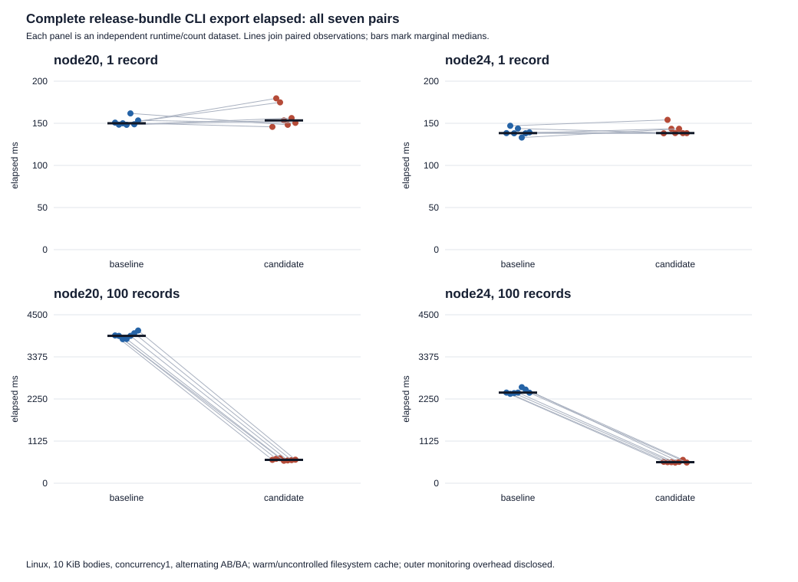

# First paired complete-operation results at c491

Related to [#96](https://github.com/deveshsangwan/html-inbox/issues/96) and [PR122](https://github.com/deveshsangwan/html-inbox/pull/122).
Grant `root-96-paired-c491-20261108-r1` completed once at clean candidate
`c4914196d275b0dac2a60e9dc09353a29da49f01` versus actual parent
`b24927abf4cae14c9bbf1753ff6ea2cfb7a945ad`. All four outer commands,158
child rows and both independent audits passed. Slot explicitly released before
packaging. Root independently audited and accepted scoped practical benefit for
the complete100-record/10KiB export on this host, separately on each runtime.
One-record benefit is unproven. Normal full qualification, shared correctness
gates and reviews remain open; full#96 readiness is not accepted. No retry,
workload substitution or early gain-based stopping occurred.

## Primary complete release-bundle CLI export

Seven alternating AB/BA pairs per count/runtime,10240-byte distinct owned bodies,
concurrency1. Each export is a fresh process with full startup, selection, checked
ledger/body reads, validation, output writes and exit. Counts1 and100 were fixed
before execution; runtimes and their fresh fixtures are independent. Filesystem
cache is uncontrolled/warm. No process pooling, p95 or cache-cold claim.

Baseline/candidate columns are marginal medians. Delta and percent columns are
**medians of the seven paired changes**, not the difference/ratio of those
marginal medians. Negative changes favor candidate. Display rounded to3 decimals;
original precision remains in the CSV and immutable JSON.

| Runtime | Records | Baseline median ms | Candidate median ms | Paired Δ median ms | Paired % median | Paired Δ min…max ms | Paired Δ IQR ms | Faster pairs |
| --- | ---: | ---: | ---: | ---: | ---: | --- | ---: | ---: |
| node20 | 1 | 150.020 | 153.405 | +5.221 | +3.524% | -13.528…31.246 | 20.057 | 3/7 |
| node20 | 100 | 3935.809 | 623.879 | -3322.915 | -84.418% | -3449.989…-3179.200 | 89.357 | 7/7 |
| node24 | 1 | 138.336 | 138.377 | +0.130 | +0.094% | -5.432…10.407 | 6.812 | 3/7 |
| node24 | 100 | 2420.606 | 562.002 | -1865.024 | -76.671% | -1995.782…-1825.368 | 26.311 | 7/7 |

All seven100-record pairs were lower on each runtime, with baseline/candidate
ranges separated: Node20 baseline3847.506–4078.229ms versus600.300–668.305ms;
Node24 baseline2387.370–2565.032ms versus551.773–622.983ms. This is the observed
large-workload separation in this run, not a pooled runtime result.

At one record, candidate was lower in only3/7 pairs on each runtime. Observed
paired median increases were+5.221ms/+3.524% on20 and+0.130ms/+0.094% on24,
with paired ranges spanning both directions. Node20 candidate range was
145.771–179.602ms versus148.184–161.745ms baseline. No small-workload speedup
is claimed. The runner polls at5ms; these overlapping small samples do not
establish a gain. Their observed increases remain costs/uncertainty to assess.

## Supporting complete operations and memory

The batch entry executes real serial list + all body reads + metadata equality +
whole-body digests + callback drain. Process metrics include startup; operation
metrics exclude module/input setup but include the whole callback. End RSS is
a point-in-time process measure, not peak allocation or a leak diagnosis.

| Runtime,100 records | Metric | Baseline median | Candidate median | Paired Δ median | Paired % median |
| --- | --- | ---: | ---: | ---: | ---: |
| node20 | CLI CPU ms | 4113.979 | 702.726 | -3411.253 | -82.963% |
| node20 | CLI peak RSS KiB | 112872.000 | 82312.000 | -30712.000 | -27.235% |
| node20 | Batch process ms | 3594.322 | 336.630 | -3252.619 | -90.664% |
| node20 | Batch process CPU ms | 3797.730 | 389.457 | -3406.001 | -89.769% |
| node20 | Batch process peak RSS KiB | 100624.000 | 74392.000 | -25876.000 | -25.710% |
| node20 | Batch operation ms | 3507.289 | 249.509 | -3257.779 | -92.900% |
| node20 | Batch operation CPU ms | 3705.253 | 294.863 | -3411.046 | -92.011% |
| node20 | Batch end RSS bytes | 101945344.000 | 75341824.000 | -26816512.000 | -26.217% |
| node24 | CLI CPU ms | 2448.777 | 634.342 | -1820.666 | -73.996% |
| node24 | CLI peak RSS KiB | 98108.000 | 94236.000 | -3764.000 | -3.837% |
| node24 | Batch process ms | 2114.586 | 304.307 | -1808.077 | -85.719% |
| node24 | Batch process CPU ms | 2121.765 | 347.047 | -1779.261 | -83.626% |
| node24 | Batch process peak RSS KiB | 85116.000 | 85076.000 | -144.000 | -0.169% |
| node24 | Batch operation ms | 2030.719 | 218.511 | -1821.346 | -89.192% |
| node24 | Batch operation CPU ms | 2024.522 | 246.615 | -1781.435 | -87.905% |
| node24 | Batch end RSS bytes | 84672512.000 | 87052288.000 | +2482176.000 | +2.914% |

Node24 batch end-RSS is an explicit tradeoff: paired median+2482176bytes,
+2.914%, range−921600…3223552bytes. Its process peak-RSS paired median is
−144KiB; these different measures must not be substituted for each other.
Node20 batch end-RSS paired median was−26816512bytes. At one record, batch
process paired elapsed medians were+2.380ms on20 and+0.255ms on24, with
mixed-sign ranges. All count1 CPU/RSS and other metrics are retained, not filtered.

The candidate bundle is1283240bytes versus1276123 parent, a7117byte/+0.558% increase.
Exact accepted SHA256 values remain7f8fa149cb7233b41cd1671089bcb76ac15ebdd2fb3323ce64a40ca644b70509
and9e7b74b25117b23e64de30d16624dca18c4e503f4ce4375185d68af8c77afdd5.

## I/O and preserved behavior

All16 raw before/after seven-field profiles were independently reparsed without
the tested parser/application imports. The separately instrumented probes never
entered primary timing labels. For both revisions on each runtime:

| Records | Complete operation | Ledger opens | Checked ledger bytes | Body opens/bytes |
| ---: | --- | ---: | ---: | --- |
| 1 | CLI export | 3 | 5706 | 1 /10240 |
| 1 | Batch | 2 | 3804 | 1 /10240 |
| 100 | CLI export | 102 | 8625528 | 100 /1024000 |
| 100 | Batch | 101 | 8540964 | 100 /1024000 |

No checked-byte I/O reduction is claimed. Full serialized ledger bytes are still
read per body, retaining residual O(N)-bytes-per-body cost. Native counts and
rchar/syscr bounds passed. Physical read_bytes and process input-block medians
were0 with warm/tmpfs cache behavior; that is not zero managed I/O. CLI output
block medians were224 at1 and6896 at100, equal across revisions. Derived ledger
sizes1902/84564 are consistency checks for these fixtures only. Source-pinned
live ledger.stat assertions checked every count/profile; no ledger or separate
stat was retained/recovered, and neither size is an auditor constant.

All76 export trees/11452 files/76 manifests and snapshot hashes passed. Six API
pairs matched every byte;32 CLI/count pairs matched stable bytes with only named
ownership/manifest nonce distinctions. Manifest structure was compared after
only those generatedAt/derived hash fields. Original owner/time/outputDir values
are retained. Every repeated label was audited using row index plus count/pair/
role/operation/output identity; no sample was overwritten. Existing mixed-origin,
tombstone/suppression, complete-batch and output/diagnostic checks remained intact.
No cross-runtime whole-output normalization or equality claim.

## Provenance, cleanup and limits

Reused accepted400 candidate/392 parent compiled files, both bundles and successful
44ef typecheck. All335 reusable inputs, source/ref/index states,2 runtimes and8+13
recorded tool maps remained unchanged. Missing retrospective installed transitive
declaration/tool-library hashes remain explicit. No build/install/typecheck/bundle
mutation, pure/helper test, full suite, actual browser/listener/worker or reviewer
ran. Both source and generated maps remain in immutable receipts.

The approved outer controller samples /proc at100ms without hot fixture traversal.
The existing primary timing runner/environment is unchanged. Monitoring overhead
remains and can miss shorter-lived descendants; this is not an uninstrumented-host
claim. Raw sample PIDs/groups were checked additionally. No unused timeout/
interruption or generic OS-close guarantee is established by normal completion.

All162 observed or recorded sample PIDs,162 groups and10 command/fixture roots
were absent; no adopted reaps/controller signals. Slot RELEASED
2026-11-08T18:24:14.156627Z before packaging. Application155.914928seconds within
the single900second deadline; automated cleanup0.004969seconds. Final read-only
inspection after controller finish was61.496271seconds, giving a conservative
combined cleanup/inspection bound61.501240seconds under the fixed120second
allowance. Additive inspection was not separately timed.

Root accepted the scoped large-export result after independently reconstructing
every row/order/command, all28 pairs across11 metrics and both summaries; rehashing
all11452 files/76 trees; independently parsing all16 raw I/O profiles; and checking
provenance and cleanup. Root audit SHA256
`869f37aa137191e59e9939e8968b3c4e996fe8e47a9e0ac1cddee72d3f490370`,
local record `/home/agent/programming/html-inbox/artifacts/performance-issues-2026-11-07/issue96-paired-c491-root-audit.json`.
Unresolved dc28 Windows legacy-deletion and Ubuntu LENGTH observations, normal
full/package qualification and two fresh same-pin full-rubric reviews remain
gates. The combined stack versus original610 criterion is separate and unmet;
these measurements isolate96 against its actual b249 parent. No1000/larger-body expansion, automatic next phase, full#96
closure, merge or release. Historical logs/stops/invalid instrumentation stay separate.

## Complete statistics and raw evidence

[All308 pair/metric values](paired-values-c491419.csv) and
[all44 runtime/count/metric descriptive rows](paired-statistics-c491419.csv) retain
full numeric precision, all baseline/candidate/paired arrays and min/median/max/
range/Q1/Q3/IQR. Quartiles use the inclusive method; baseline-zero relative
changes remain undefined. No p95 or statistical significance estimate. Original
raw rows, every file/manifest, independent audits and source/controller hashes
are in the accompanying lossless archive. Standalone CSV copies use LF line
endings; their original CRLF archive copies and every numeric value are preserved.

[Lossless archive](paired-performance-c491419.tar.gz),4539686bytes, SHA256
`676918f0018dfb5d762c4e83bb4ae64c4f9c3348cdd3b9822fb2526bb90f4f11`.
All11510 file members were compared byte-for-byte to disk;11509 execution
artifact hashes are separate from the unchanged original five-file source
manifest. It includes every raw sample, full metric arrays/summaries,16 raw I/O
profiles,11452 output files,76 manifests, controllers/diffs and release/identity
receipts. No raw receipt was rewritten. Temporary tooling data did not exist
in this tool-free phase; no managed ledger or private key was captured.
